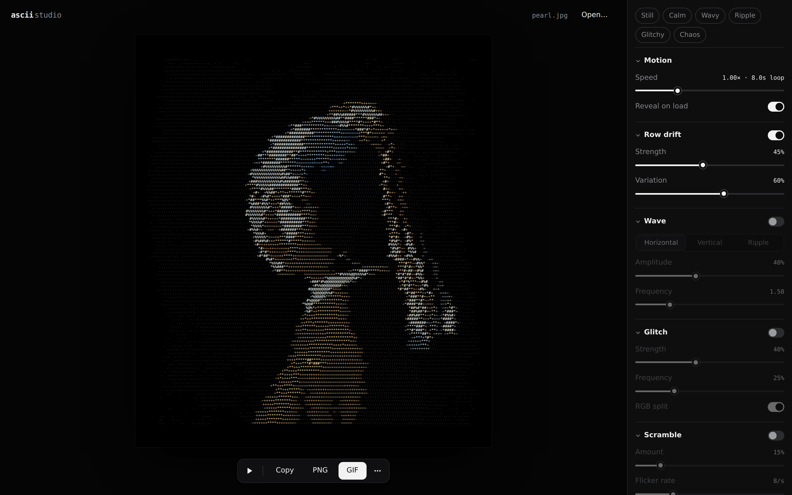

<p align="center"></p>
<h1 align="center">
  <picture>
    <source media="(prefers-color-scheme: dark)" srcset="docs/wordmark-dark.png">
    
  </picture>
</h1>
<p align="center">Turn any image into animated ASCII art, then save it as a PNG or a looping GIF.</p>

<p align="center"></p>

Runs in the browser or as a desktop app (Windows, macOS, Linux). Images never leave your device.

**Try it live: [ascii-react.vercel.app](https://ascii-react.vercel.app)**

## Features

- **Load images any way you like:** drop, paste (Ctrl/⌘+V), or pick a file
- **Live preview** on a canvas, adjusted in real time
- **Motion effects**, each with its own controls:
  - **Row drift:** rows float left and right independently
  - **Wave:** horizontal, vertical, or a radial ripple
  - **Glitch:** bands of rows jump sideways, with optional RGB split
  - **Scramble:** glyphs flicker to random characters
- **Speed** control, plus presets (Still, Calm, Wavy, Ripple, Glitchy, Chaos)
- **Image controls:** detail (columns), character set (including your own), contrast, brightness, invert, colour from the image or a single colour, background, font size, line height, padding
- **Export:**
  - **Copy:** the current frame as an image on your clipboard
  - **PNG:** the current frame at 1×, 2× or 4×
  - **GIF:** exactly one loop of the animation, so it repeats with no visible jump
- Settings are remembered between sessions

### Shortcuts

| Key | Action |
| --- | --- |
| Space | Play / pause |
| Ctrl/⌘ + O | Open image |
| Ctrl/⌘ + V | Paste image |
| Ctrl/⌘ + C | Copy current frame |
| Ctrl/⌘ + S | Save PNG |
| Ctrl/⌘ + Shift + S | Save GIF |

## Build from source

You need [Node.js](https://nodejs.org) 20 or newer.

### Web app

```bash
npm install
npm run dev      # dev server on http://localhost:5173
npm run build    # static site in dist/
```

### Desktop app

You also need [Rust](https://rustup.rs) and [Tauri's system prerequisites](https://v2.tauri.app/start/prerequisites/). On Windows and macOS that's usually nothing extra. On Debian/Ubuntu:
`sudo apt install libwebkit2gtk-4.1-dev build-essential libssl-dev libayatana-appindicator3-dev librsvg2-dev`.

```bash
npm install
npm run desktop          # run the desktop app in dev mode
npm run desktop:build    # build an installer for your OS
```

The installer is written to `src-tauri/target/release/bundle/`.

### Releases

Pushing a tag like `v1.0.0` runs `.github/workflows/release.yml`. It builds installers for Windows (`.msi`/`.exe`), macOS (`.dmg`, Intel + Apple Silicon) and Linux (`.AppImage`/`.deb`) and attaches them to a draft GitHub Release.

## How it works

```
src/
  engine/
    convert.ts     image pixels → glyph grid (one pixel per cell, brightness → character ramp)
    effects.ts     drift / wave / glitch / scramble, all pure functions of loop "phase"
    render.ts      draws a frame to a canvas (used by the preview, PNG and GIF)
    gif.ts         renders one loop of frames; gif.worker.ts encodes them with gifenc
  lib/             image loading, save/copy (browser vs. desktop)
  state/           settings, presets, persistence
  components/      UI
src-tauri/         desktop shell
```

Every effect is periodic in a `phase` value that runs from 0 to 1 over one loop. Sine-based motion completes whole cycles, and random effects use a seeded hash of the time step. Phase 0 and phase 1 therefore produce identical frames, which is why exported GIFs loop seamlessly. The speed setting only changes how many seconds one loop lasts.

```bash
npm test         # engine unit tests (conversion + seamless-loop checks)
```

## License

MIT
